# ТалерБанк

Система дистанционного банковского обслуживания физических лиц. Курсовой проект (БГУИР, «Проектирование и разработка web-приложений»). Тема: «Дистанционное банковское обслуживание и программная поддержка действий пользователя по управлению персональными счетами».

ТалерБанк — учебный проект, названия и данные вымышленные. Реальной банковской деятельности система не ведёт.

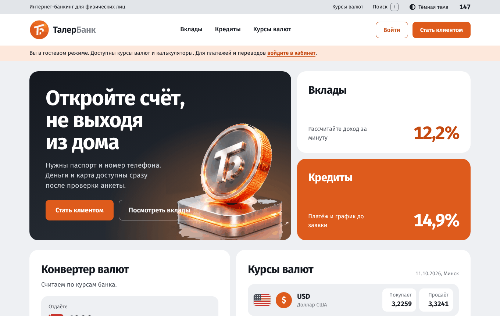

## Что умеет система

**Клиент**
- регистрация по анкете, проверка анкеты сотрудником, открытие счетов в BYN, USD, EUR, RUB и CNY (номер в формате IBAN Беларуси, контроль mod 97);
- переводы между своими счетами с конвертацией, переводы клиентам банка по IBAN, переводы в другие банки через клиринг, подтверждение кодом;
- оплата услуг по каталогу (по образцу ЕРИП), шаблоны платежей, автоплатежи, квитанции в PDF;
- вклады с калькулятором дохода, досрочное закрытие с перерасчётом;
- кредиты: калькулятор, график платежей (аннуитетный и дифференцированный), скоринг логистической регрессией (вероятность дефолта с объяснением вклада признаков), подписание договора кодом, частичное и полное досрочное погашение;
- банковские карты: выпуск, лимиты, блокировка, онлайн-покупки, имитация терминала;
- выписка по счёту (экран и PDF), справка об остатке, курсы валют и конвертер;
- коды подтверждения и уведомления на электронную почту (вместо SMS, настраивается SMTP), быстрый поиск по разделам, тёмная тема, двухфакторная защита (TOTP).

**Сотрудники банка** (роли с разными правами)
- операционист: проверка анкет, касса, входящие межбанковские платежи, блокировка счетов;
- кредитный специалист: очередь и анкеты заявок на кредит, решение;
- специалист по финансовому мониторингу: антифрод, задержанные переводы (внутри банка и в другие банки), операции особого контроля;
- администратор: курсы и тарифы, пользователи и роли, журнал аудита, резервные копии, отчёты и ОСВ, закрытие операционного дня, клиринг.

**Безопасность**: пароли bcrypt, сессии в MySQL, CSRF-токены, CSP и другие заголовки helmet, ограничение попыток входа, паспортные данные шифруются AES-256-GCM, двухфакторная защита TOTP, неизменяемый журнал аудита, резервные копии с шифрованием.

## Скриншоты

| | |
|---|---|
| 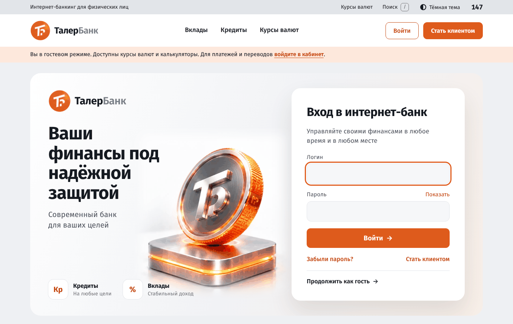 | 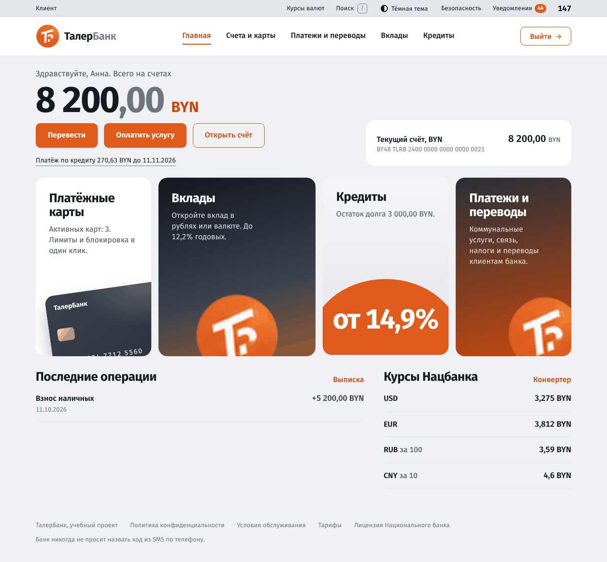 |
| Вход | Кабинет клиента |
| 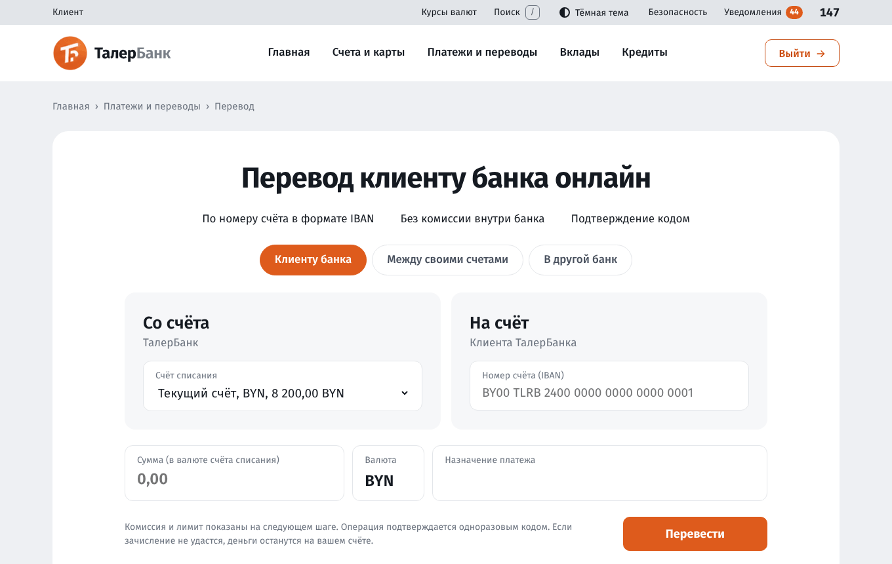 | 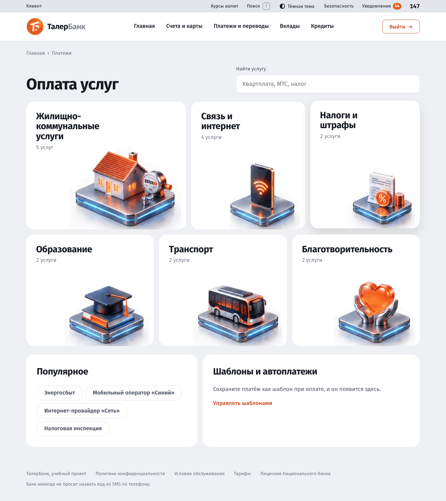 |
| Перевод клиенту банка | Оплата услуг |
| 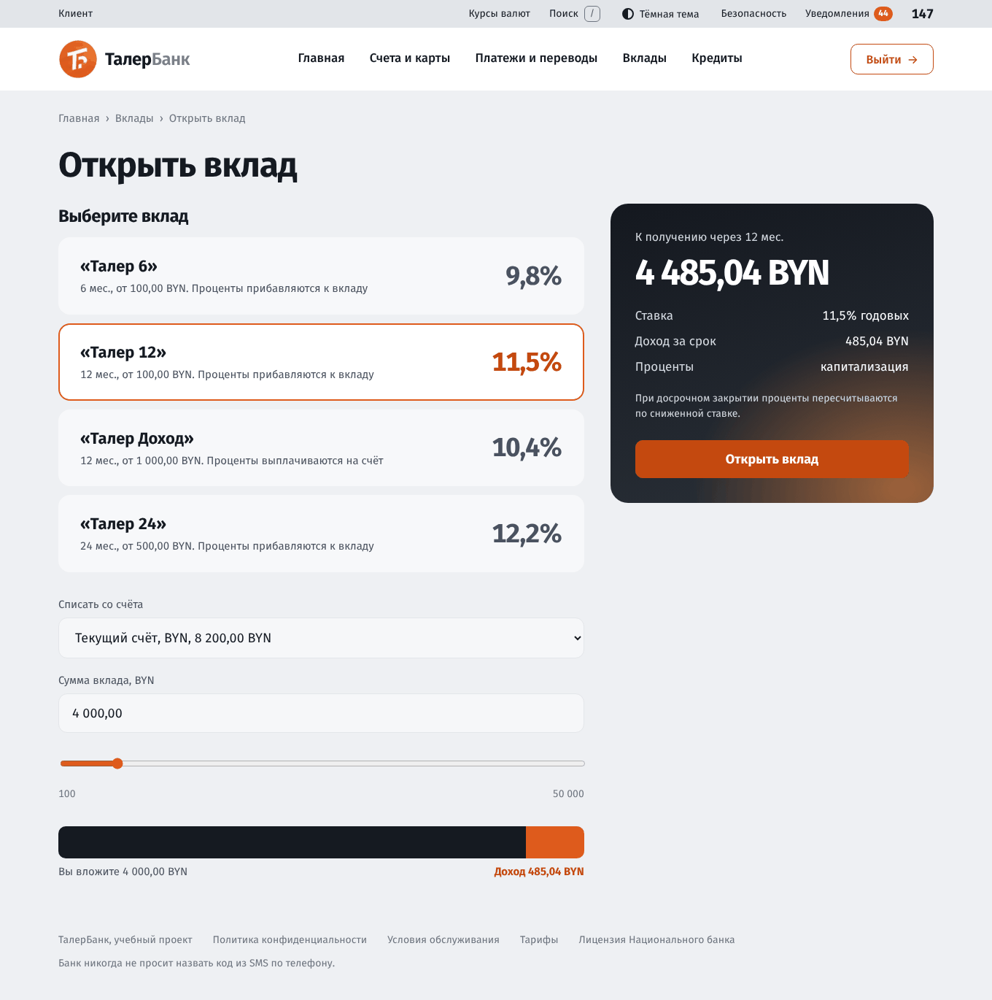 | 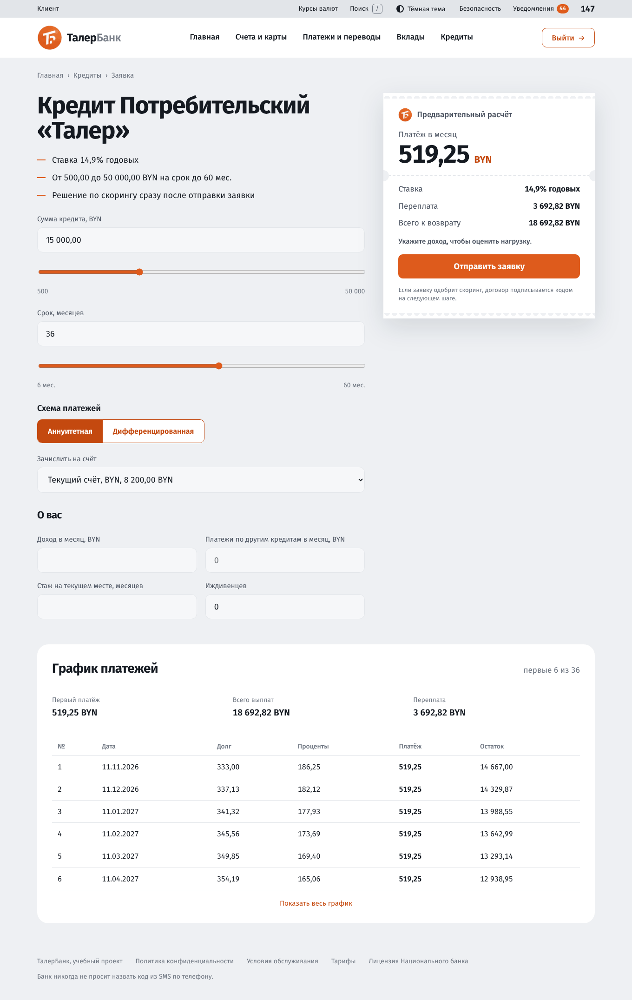 |
| Открытие вклада | Заявка на кредит |
| 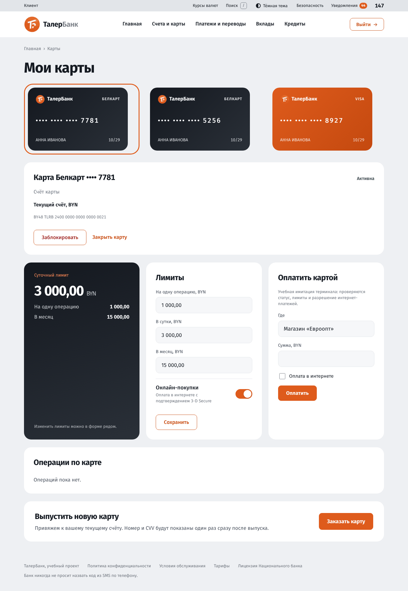 | 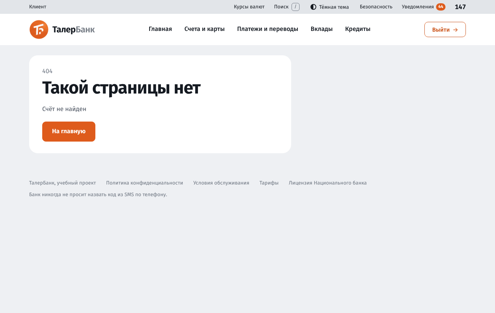 |
| Карты | Выписка |
| 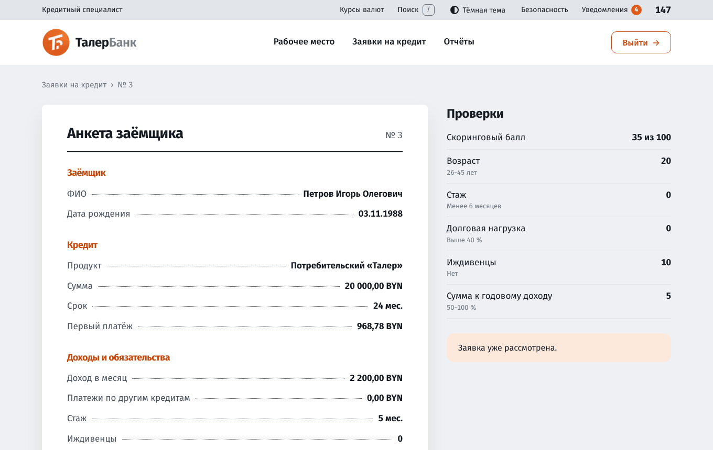 | 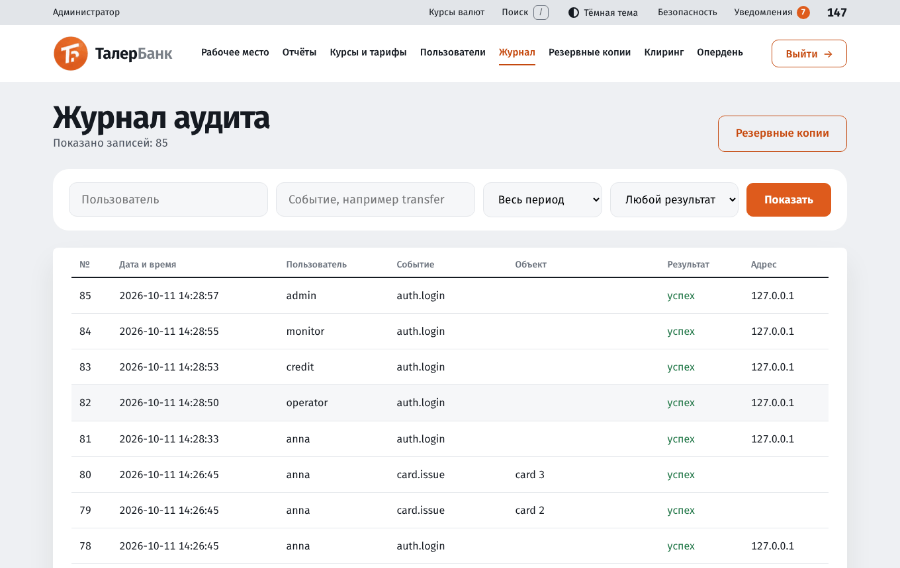 |
| Анкета заёмщика (кредитный специалист) | Журнал аудита (администратор) |
| 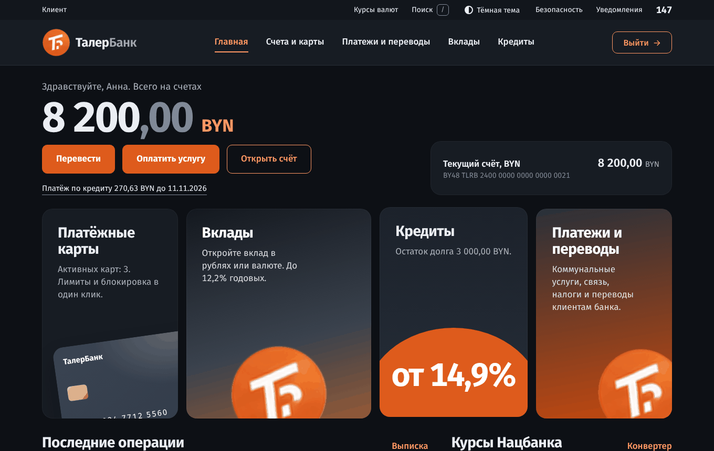 | 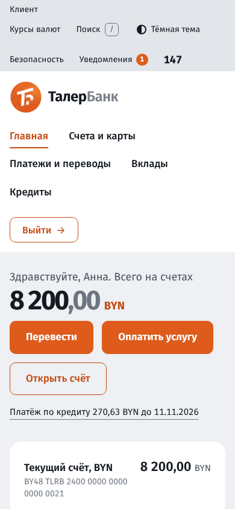 |
| Тёмная тема | Мобильная версия |

Остальные экраны смотрите в [руководствах пользователя](#документация).

## Быстрый запуск

Подробная пошаговая инструкция для Windows: [docs/install.md](docs/install.md). Кратко:

1. Установите Node.js 20 или новее и MySQL 8.
2. Создайте пользователя и базы (в клиенте mysql под администратором):

   ```sql
   CREATE USER 'taler'@'%' IDENTIFIED BY 'taler';
   CREATE DATABASE talerbank CHARACTER SET utf8mb4;
   CREATE DATABASE talerbank_test CHARACTER SET utf8mb4;
   GRANT ALL PRIVILEGES ON talerbank.* TO 'taler'@'%';
   GRANT ALL PRIVILEGES ON talerbank_test.* TO 'taler'@'%';
   GRANT RELOAD ON *.* TO 'taler'@'%';
   ```

3. В папке проекта:

   ```
   npm install
   npm run setup
   npm run db:migrate
   npm run db:seed
   npm start
   ```

4. Откройте http://localhost:3000.

`npm run setup` создаёт файл `.env` со случайными ключами. Если у MySQL другой пароль или имя базы, поправьте строку `DATABASE_URL` в `.env`.

### Демонстрационные пользователи

Пароль у всех `Taler2026`.

| Логин | Роль | Что посмотреть |
|---|---|---|
| `anna`, `igor` | Клиент | счёт с деньгами, переводы, платежи, вклады, кредиты, карты |
| `operator` | Операционист | анкеты, касса, счета клиентов |
| `credit` | Кредитный специалист | заявки на кредит |
| `monitor` | Специалист по финансовому мониторингу | антифрод |
| `admin` | Администратор | курсы, пользователи, журнал, копии, закрытие дня |

Сотрудникам при входе обязательна двухфакторная защита: при первом входе нужно настроить приложение-аутентификатор. Для разработки её можно выключить командой `npm run staff2fa:off`, включить обратно `npm run staff2fa:on`.

## Команды

| Команда | Что делает |
|---|---|
| `npm start` | запуск сервера |
| `npm run dev` | запуск с перезагрузкой при изменении файлов |
| `npm run setup` | создаёт `.env` со случайными ключами |
| `npm run db:migrate` | применяет SQL-файлы из `db/sql` |
| `npm run db:seed` | служебные счета банка и демонстрационные пользователи |
| `npm run scoring:train` | обучает и включает модель кредитного скоринга |
| `npm run er:drawio` / `npm run uml:drawio` | пересоздают диаграммы draw.io в `docs/diagrams` |
| `npm run db:schema` | собирает `db/schema.sql` (полный скрипт БД для приложения к записке) |
| `npm test` | автотесты (используют базу `talerbank_test`, пересоздают её схему) |
| `npm run staff2fa:off` / `staff2fa:on` | выключить или включить обязательную 2FA сотрудников |

После обновления кода сервер нужно перезапускать (Node не подхватывает изменения сам, кроме режима `npm run dev`).

## Архитектура

Приложение построено по схеме MVC. Модель: SQL в моделях (`models`) и бизнес-логика в сервисах (`services`). Контроллеры (`controllers`) тонкие и отдают JSON по адресам `/api/...`, маршруты (`routes`) связывают их с адресами. Представление: страницы на HTML5, CSS3 и JavaScript (`public`), без серверных шаблонов: клиентский маршрутизатор подгружает модули страниц и собирает разметку из ответов API. Подробнее: [docs/frontend.md](docs/frontend.md). Контроллеры не пишут SQL, модели ничего не знают про HTTP.

```
src/
  server.js, app.js      запуск и сборка Express
  config/                настройки из .env
  db/                    пул соединений, транзакции, миграции, seed
  routes/                таблица маршрутов API (по файлу на модуль)
  controllers/           обработчики HTTP, отдают JSON
  services/              бизнес-логика
  models/                SQL-запросы
  lib/                   деньги, IBAN, TOTP, графики, скоринг, PDF
  middleware/            сессии, CSRF, права, 2FA сотрудников
public/
  index.html             оболочка приложения
  css/style.css          единая таблица стилей всего приложения
  js/lib/                маршрутизатор, запросы к API, шаблоны html``, формы, анимации
  js/routes/, js/pages/  маршруты и страницы по модулям
  img/                   эмблема, монета, 3D-иконки
db/sql/                  схема и начальные данные (NNN_*.sql)
docs/                    руководства, концепция, скриншоты
test/                    автотесты (Vitest, supertest, MySQL)
```

Ключевые решения:

- **Двойная запись.** Любая денежная операция проходит через `ledgerService.post`: остаток счёта считается по проводкам (кредит минус дебет), счета блокируются в порядке возрастания номера, операции идемпотентны. Проводки и журнал аудита неизменяемы: запрет на изменение стоит в базе (триггеры).
- **Деньги в копейках** (BIGINT), форматирование только в `lib/money.js`. Числа с плавающей точкой для денег не используются.
- **Каждая операция в одной транзакции**, клиент транзакции передаётся в сервисы и модели параметром `db`.
- **Права, а не названия ролей.** У роли есть набор прав, маршруты проверяют право (`requirePermission`) или принадлежность к сотрудникам, но не название роли.
- **Закрытие операционного дня** (`/admin/eod`): начисление процентов по вкладам, график и просрочка по кредитам, автоплатежи, напоминания о платежах, пакет межбанковского клиринга.
- **Одна таблица стилей.** В разметке страниц нет атрибутов `style=`: этого требует политика CSP и требование задания (есть тест). Цвета задаются CSS-переменными, тёмная тема переключается классом `dark` на `<html>`.

## Тесты

```
npm test
```

274 автотеста: деньги и IBAN, проводки и идемпотентность, переводы, вклады, кредиты и график, скоринг, антифрод, карты, платежи, закрытие дня, клиринг, TOTP и 2FA, права доступа, JSON API всех модулей и ролей.

## Документация

| Документ | Для кого |
|---|---|
| [docs/install.md](docs/install.md) | руководство по установке и запуску (Windows 10+) |
| [docs/user-guide-client.md](docs/user-guide-client.md) | руководство пользователя: гость и клиент |
| [docs/user-guide-staff.md](docs/user-guide-staff.md) | руководство пользователя: сотрудники банка (операционист, кредитный специалист, специалист по мониторингу) |
| [docs/user-guide-admin.md](docs/user-guide-admin.md) | руководство пользователя: администратор |
| [docs/concept.md](docs/concept.md) | концепция: модули, роли, операционный день, функциональная модель |
| [docs/frontend.md](docs/frontend.md) | устройство интерфейса и API: маршрутизатор, страницы, формы, соглашения |
| [docs/diagrams](docs/diagrams/README.md) | диаграммы draw.io: ER базы данных, классы, варианты использования, последовательности |
| [db/schema.sql](db/schema.sql) | полный SQL-скрипт создания базы данных |

## Окружение

Серверная часть: Windows 10 и новее (а также Linux и macOS), Node.js 20+, MySQL 8. Клиент: Яндекс Браузер, Firefox, Chrome, Opera (актуальные версии). Интерфейс только на русском языке.
