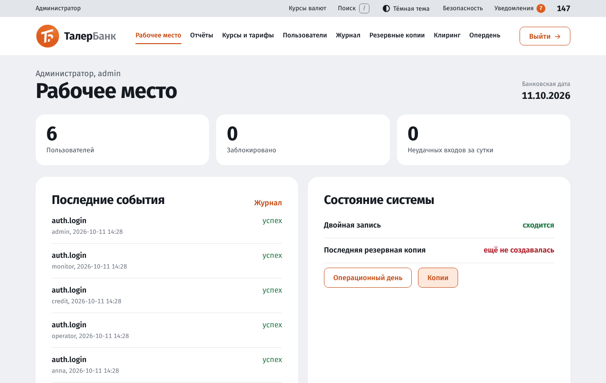
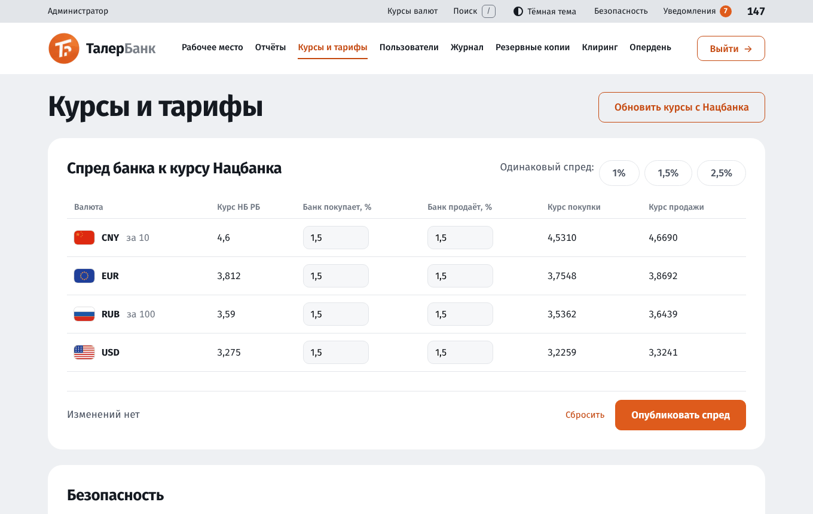
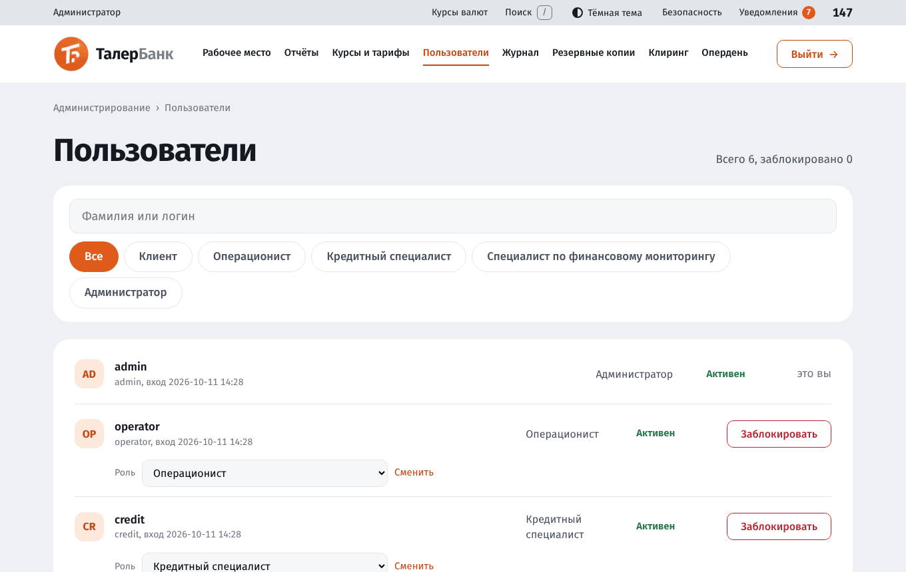
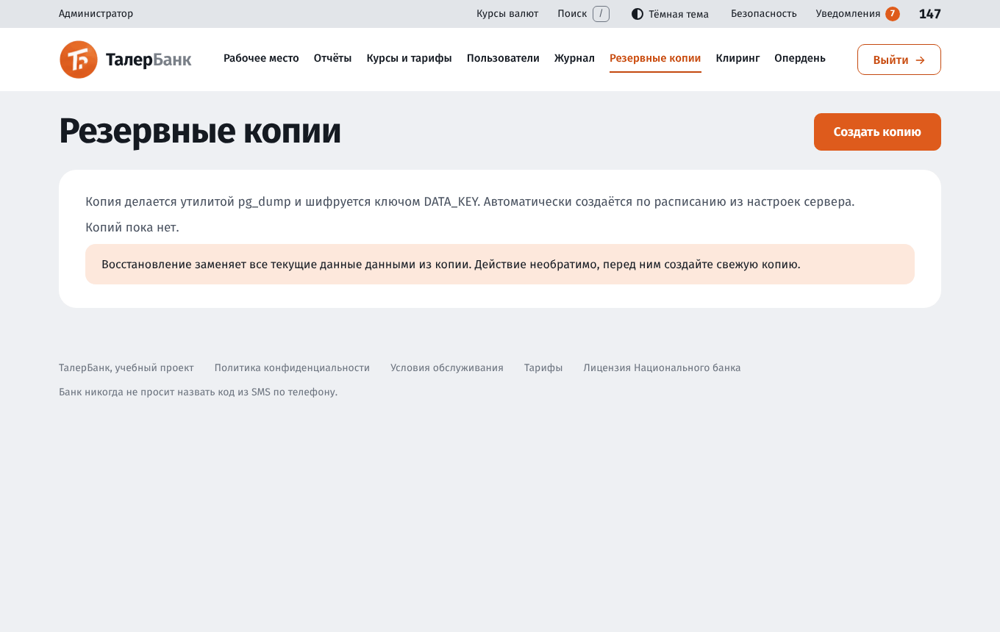
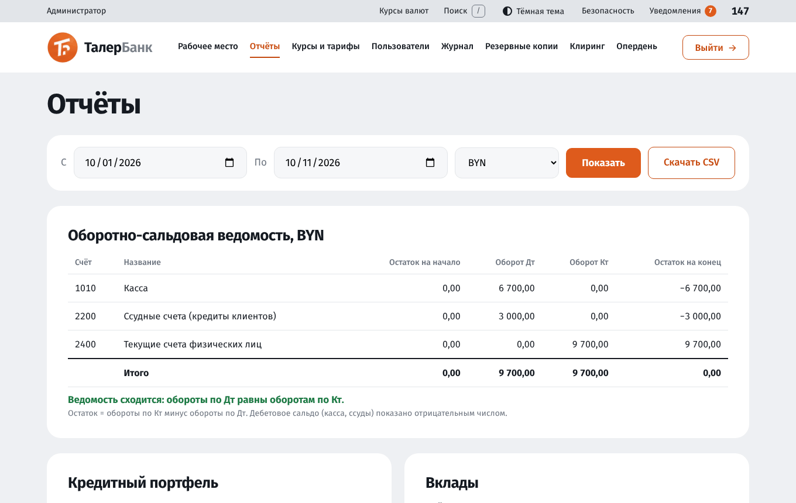
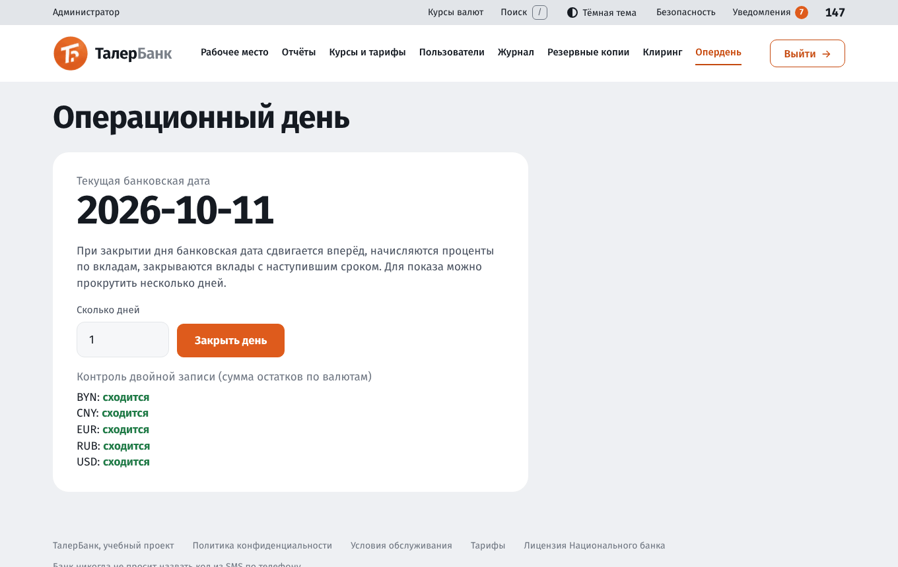
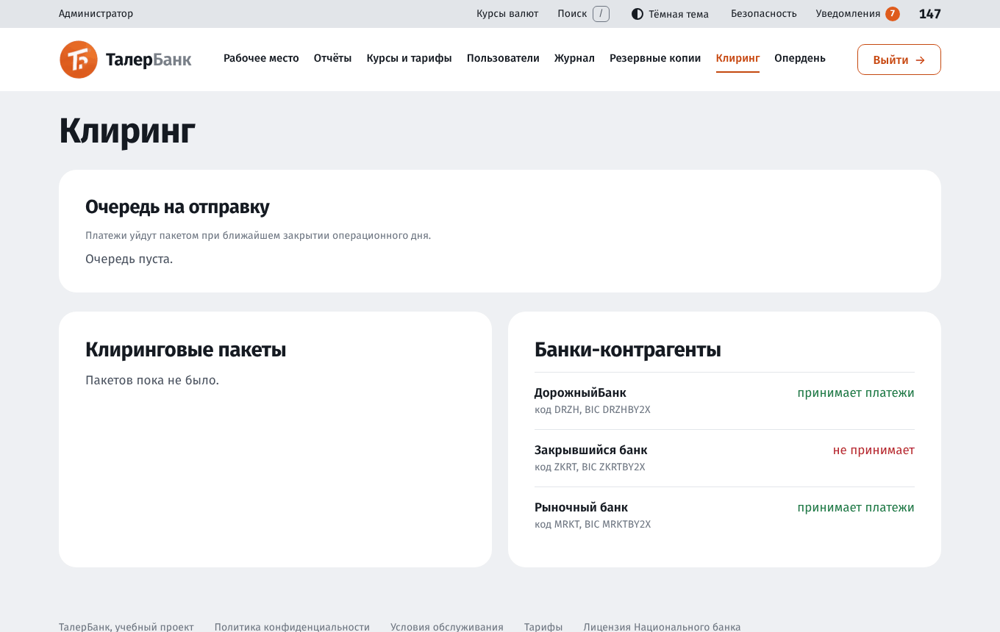

# Руководство пользователя: администратор

Администратор настраивает банк, управляет сотрудниками, контролирует журнал, делает резервные копии и закрывает операционный день. Руководства других ролей: [клиент](user-guide-client.md), [сотрудники](user-guide-staff.md). Установка и запуск: [install.md](install.md).

Демонстрационный вход: логин `admin`, пароль `Taler2026`. Для администратора, как и для всех сотрудников, обязательна двухфакторная защита (первый вход описан в [руководстве сотрудников](user-guide-staff.md#1-вход-и-двухфакторная-защита)).

## Содержание

1. [Меню администратора](#1-меню-администратора)
2. [Курсы и тарифы](#2-курсы-и-тарифы)
3. [Пользователи](#3-пользователи)
4. [Журнал аудита](#4-журнал-аудита)
5. [Резервные копии](#5-резервные-копии)
6. [Отчёты](#6-отчёты)
7. [Операционный день](#7-операционный-день)
8. [Клиринг](#8-клиринг)
9. [Рекомендации по безопасности](#9-рекомендации-по-безопасности)

## 1. Меню администратора

«Рабочее место», «Отчёты», «Курсы и тарифы», «Пользователи», «Журнал», «Резервные копии», «Клиринг», «Опердень».

На рабочем месте показана банковская дата и ближайшие задачи: например, число переводов в очереди клиринга и напоминание о закрытии дня.

## 2. Курсы и тарифы

Раздел «Курсы и тарифы» (право `rates.manage`).

### Курсы валют и спред

Курсы Национального банка (НБ РБ) загружаются при начальной настройке (`npm run db:seed`) и по кнопке **«Обновить курсы с Нацбанка»**. Нажимайте её, когда нужны актуальные курсы. Если сайт Нацбанка недоступен, используются последние сохранённые или запасные значения.

Банк работает с курсами «покупает» и «продаёт», которые отличаются от курса НБ на **спред**:

- курс покупки = курс НБ × (1 − спред покупки %);
- курс продажи = курс НБ × (1 + спред продажи %).

В таблице для каждой валюты (USD, EUR, RUB, CNY) введите проценты спреда и посмотрите результирующие курсы. Быстрые кнопки «1 %», «1,5 %», «2,5 %» подставляют одинаковый спред во все строки. Под таблицей считается число изменённых значений. «Сбросить» возвращает исходные значения, «Опубликовать спред» сохраняет их. С этого момента клиенты видят новые курсы в конвертере и при конвертации между счетами.

### Тарифы и настройки

Ниже на странице настройки по группам. Измените значение и нажмите «Сохранить тарифы». Каждое изменение записывается в журнал аудита (старое и новое значение).

| Группа | Настройка | По умолчанию |
|---|---|---|
| Безопасность | Обязательная 2FA для сотрудников (1 да, 0 нет) | 1 |
| Переводы | Суточный лимит переводов клиентам | 5 000 BYN |
| Переводы | Сумма перевода, с которой нужен код | 100 BYN |
| Переводы | Комиссия за перевод клиенту банка | 0 % |
| Межбанковские переводы | Комиссия, минимальная комиссия, максимальная сумма | 0,5 %, 0,50 BYN, 10 000 BYN |
| Кредиты | Максимальная долговая нагрузка | 40 % |
| Кредиты | Пеня за день просрочки | 0,1 % |
| Кредиты | Автоодобрение возможно до суммы | 5 000 BYN |
| Кредиты | Скоринг регрессионной моделью (1 да, 0 балльная карта) | 1 |
| Кредиты | Автоодобрение при вероятности дефолта не выше / ручное рассмотрение не выше | 8 % / 30 % |
| Кредиты | Балл для автоодобрения / для ручного рассмотрения (балльная карта) | 70 / 45 |
| Антифрод | Пороги крупной суммы, суммы новому получателю, суммы новичка | 3 000 / 1 000 / 500 BYN |
| Антифрод | Число переводов за период и сам период | 4 за 10 минут |
| Антифрод | Балл риска для кода подтверждения / для задержки | 30 / 60 |
| Антифрод | Порог особого контроля (Закон № 165-З) | 20 000 BYN |

Значения денег вводятся в BYN (например `1500,00`), проценты и баллы числом. При неверном значении под полем появится сообщение.

### Скоринговая модель

Решение по заявке на кредит принимает **логистическая регрессия**: по шести признакам заёмщика (возраст, доход, долговая нагрузка, стаж, иждивенцы, отношение суммы кредита к годовому доходу) она считает вероятность дефолта. Не выше порога автоодобрения и сумма до лимита: кредит одобряется; не выше порога ручного рассмотрения: заявка уходит кредитному специалисту; выше: отказ. Нагрузка выше 40 % даёт отказ в любом случае.

Модель обучается командой `npm run scoring:train` (необязательный параметр: число записей истории, по умолчанию 6000). Реальных данных банка нет, поэтому обучающая история синтетическая: она формируется по известной зависимости с шумом, а модель её восстанавливает. Команда печатает коэффициенты и качество на отложенной выборке (точность, AUC, KS) и делает новую версию активной. Начальная модель создаётся при `npm run db:seed`. Если модели нет или переключатель «Скоринг регрессионной моделью» выключен, работает прежняя балльная карта.

## 3. Пользователи

Раздел «Пользователи» (право `users.manage`).

- Сверху показано «Всего N, заблокировано M».
- Поиск работает по фамилии или логину. Чипы ролей («Клиент», «Операционист», «Кредитный специалист», «Специалист по мониторингу», «Администратор») фильтруют список.
- У каждого пользователя показаны инициалы, имя, логин, время последнего входа, роль и статус.

### Блокировка и разблокировка

Нажмите «Заблокировать» (или «Разблокировать») в строке пользователя. Под строкой появится запрос подтверждения: нажмите «Подтвердить». Заблокированный пользователь не сможет войти. Свою учётную запись заблокировать нельзя (показано «это вы»).

### Смена роли сотрудника

У сотрудников под строкой есть выбор роли и ссылка «Сменить». Роль клиента изменить нельзя.

### Добавление сотрудника

Внизу страницы форма «Добавить сотрудника»: логин, пароль, роль. Новый сотрудник при первом входе настроит двухфакторную защиту.

Каждое действие записывается в журнал аудита.

## 4. Журнал аудита

Раздел «Журнал» (право `audit.view`).

В журнал попадают входы и выходы, действия с деньгами, решения по анкетам, заявкам и антифроду, изменения настроек, блокировки и просмотры персональных данных. Для каждой записи: номер, дата и время, пользователь, событие (например `auth.login`, `transfer.confirm`, `settings.update`), объект, результат (успех или отказ) и адрес.

Фильтры: пользователь (часть логина), событие (начало названия, например `transfer`), период (сутки, три дня, неделя), результат. Нажмите на строку, чтобы раскрыть подробности (адрес и дополнительные данные в формате JSON).

**Журнал только дописывается.** Изменить или удалить запись нельзя: это запрещено триггерами в самой базе данных, а не только приложением.

## 5. Резервные копии

Раздел «Резервные копии» (право `backup.manage`).

- **«Создать копию»** делает копию базы утилитой `pg_dump` и шифрует её ключом `DATA_KEY`.
- Копии создаются также **автоматически по расписанию** (по умолчанию раз в 24 часа, настраивается в `.env`: `BACKUP_INTERVAL_HOURS`). Хранятся последние `BACKUP_KEEP` копий (14).
- В списке показаны дата, размер и кнопка **«Восстановить»**.

**Восстановление заменяет все текущие данные данными из копии и необратимо.** Перед восстановлением создайте свежую копию. Для восстановления нужны утилиты `pg_restore` и тот же `DATA_KEY`, которым копия была зашифрована.

Файлы копий лежат в каталоге `backups` (или в `BACKUP_DIR`). Для надёжности копируйте их на отдельный носитель.

## 6. Отчёты

Раздел «Отчёты» (право `reports.view`).

- **Оборотно-сальдовая ведомость (ОСВ)** за выбранный период и валюту: для каждого балансового счёта остаток на начало, обороты по дебету и кредиту, остаток на конец, строка «Итого». Остаток считается как обороты по кредиту минус обороты по дебету, поэтому дебетовое сальдо (касса, ссуды) показано отрицательным числом. Кнопка «Скачать CSV» сохраняет ведомость в файл для Excel.
- **Кредитный портфель**: число действующих кредитов, основной долг, просроченный долг и доля просрочки.
- **Вклады**: число и сумма действующих вкладов по валютам.
- **Доходы и расходы**: накопленные доходы банка (комиссии, проценты) и расходы (проценты по вкладам) по валютам.

Контрольный итог: суммы по дебету и кредиту сходятся. Если нет, при закрытии операционного дня система покажет расхождение.

## 7. Операционный день

Раздел «Опердень» (право `eod.run`).

Показана текущая банковская дата. Кнопка **«Закрыть день»** (можно указать, сколько дней закрыть подряд) выполняет за каждый день:

1. сдвиг банковской даты вперёд;
2. начисление процентов по вкладам, закрытие вкладов с наступившим сроком;
3. очередные платежи по кредитам, учёт просрочки и пени;
4. автоплатежи клиентов;
5. напоминания клиентам о предстоящих платежах;
6. отправку пакета межбанковских платежей (клиринг);
7. **контроль двойной записи**: суммы остатков по каждой валюте должны сходиться (в сумме ноль). Результат показан на странице.

Все операции каждого дня выполняются в одной транзакции: либо день закрывается полностью, либо не закрывается совсем.

В учебной версии день закрывается вручную, в реальной системе эту операцию запускали бы по расписанию.

## 8. Клиринг

Раздел «Клиринг» (право `eod.run`).

- **Очередь на отправку**: межбанковские переводы клиентов, ожидающие закрытия дня. Для каждого видны получатель, платёж и комиссия.
- **Клиринговые пакеты**: история отправленных пакетов с суммой и числом отклонённых платежей. Платёж отклоняется, если банк получателя неактивен: клиент получает уведомление с причиной, а деньги разблокируются.
- **Банки-контрагенты**: код, BIC и признак активности. Деактивация банка заставляет его платежи отклоняться.

Входящие платежи из других банков регистрирует операционист в разделе «Входящие».

## 9. Рекомендации по безопасности

- Храните `DATA_KEY` и файл `.env` отдельно и надёжно. Потеря `DATA_KEY` делает невозможным восстановление зашифрованных данных и копий.
- Регулярно проверяйте журнал аудита на необычные входы и действия.
- Не отключайте обязательную двухфакторную защиту сотрудников в рабочей эксплуатации (команда `npm run staff2fa:off` предназначена для разработки и демонстрации).
- Выдавайте сотрудникам минимально необходимую роль и блокируйте уволенных.
- Делайте копии перед обновлением системы, перед закрытием нескольких дней подряд и перед восстановлением.
- Публиковать приложение стоит только по HTTPS с `NODE_ENV=production`.
