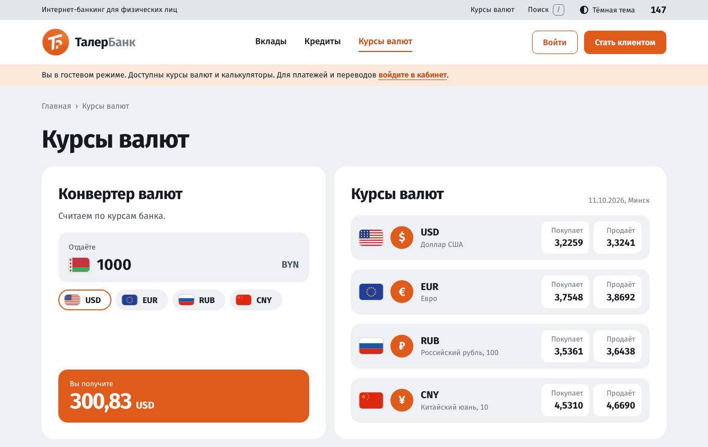
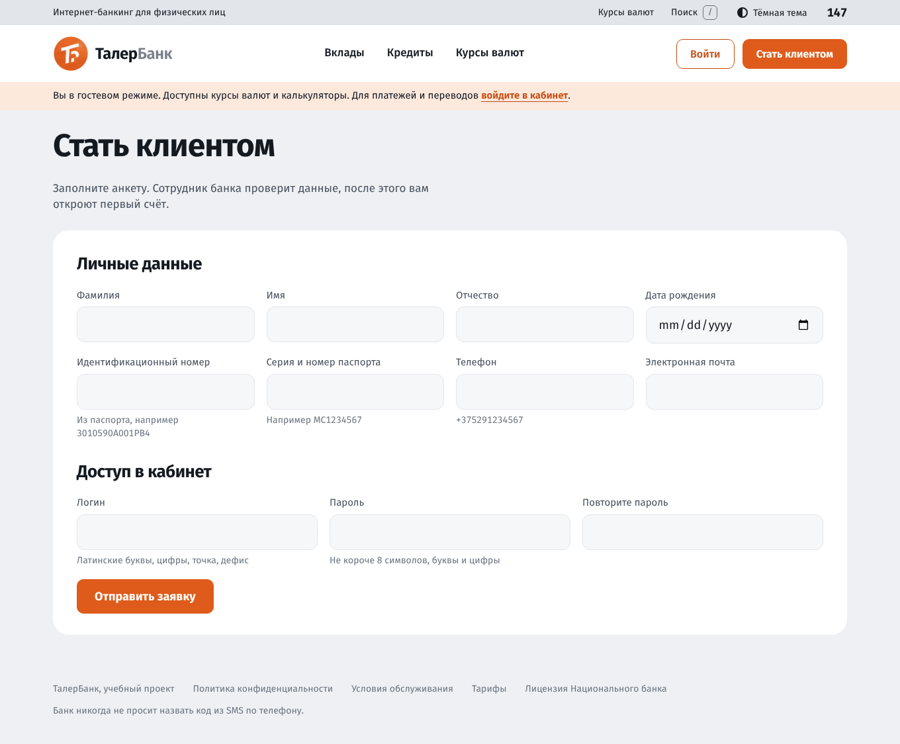
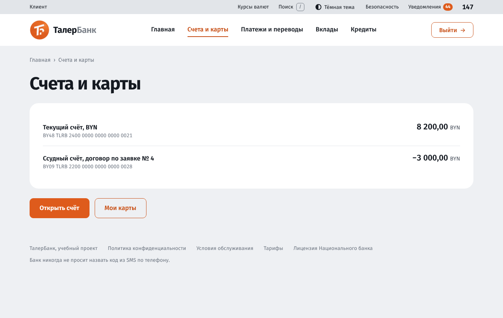
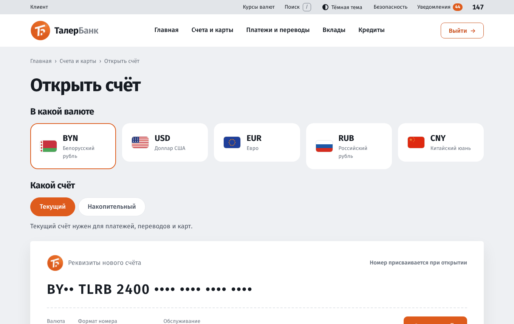
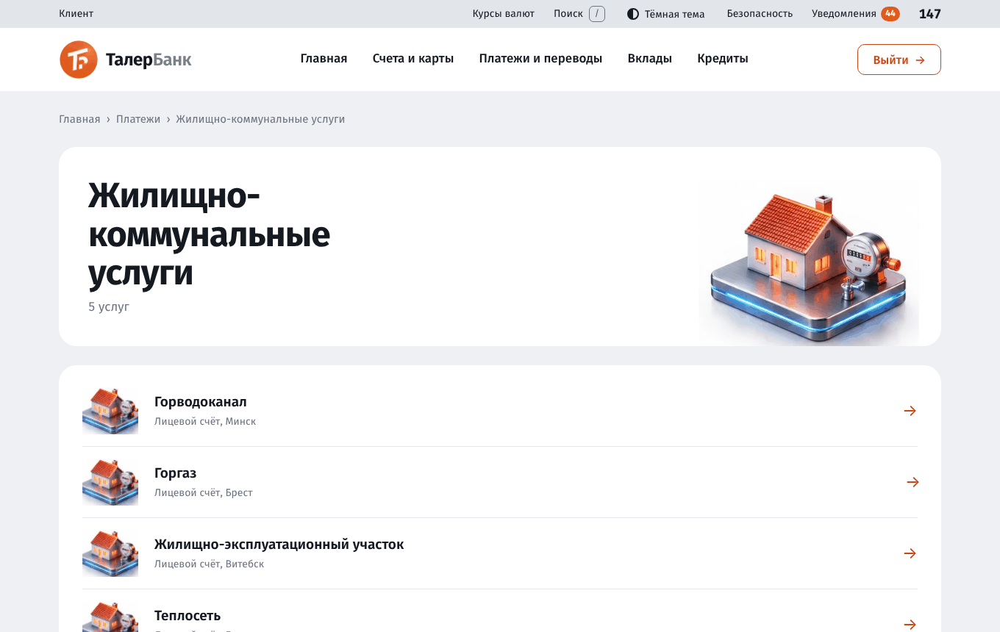
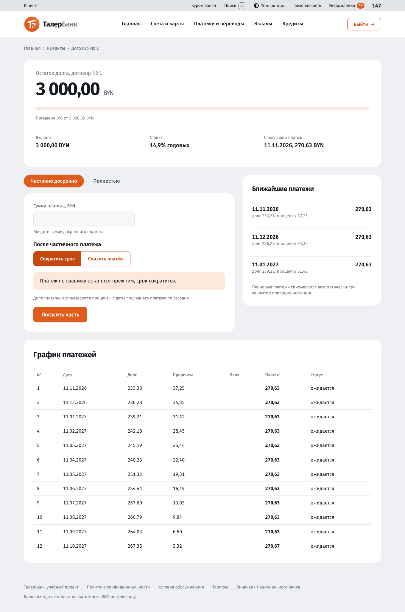
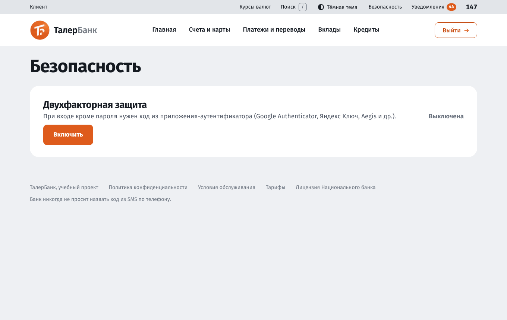
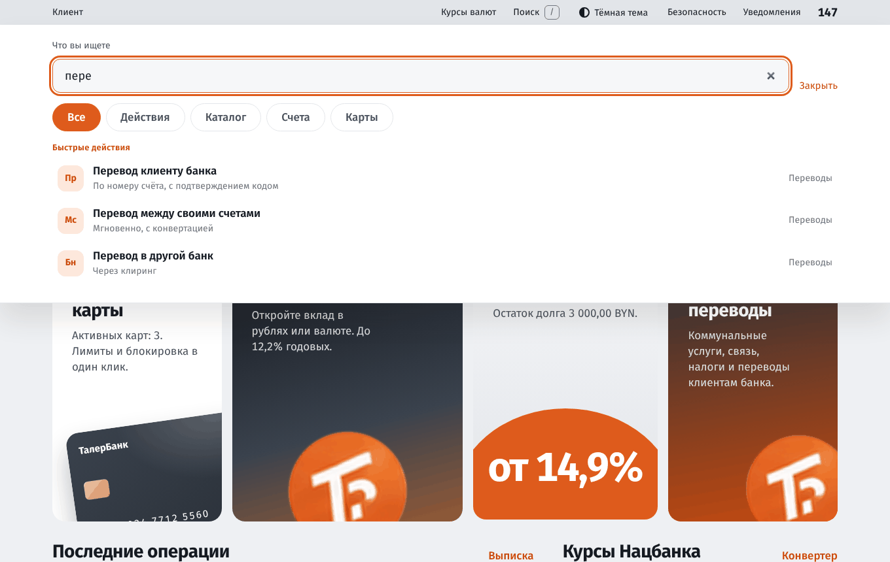

# Руководство пользователя: гость и клиент

Руководство описывает работу в интернет-банке ТалерБанк для двух ролей: **Гость** (не вошёл в систему) и **Клиент** (физическое лицо, имеющее логин и пароль). Для сотрудников банка и администратора есть отдельные руководства: [сотрудники](user-guide-staff.md) и [администратор](user-guide-admin.md).

Интерфейс только на русском языке. Поддерживаются Яндекс Браузер, Firefox, Chrome и Opera.

## Содержание

1. [Общие сведения об интерфейсе](#1-общие-сведения-об-интерфейсе)
2. [Гость](#2-гость)
3. [Регистрация и вход](#3-регистрация-и-вход)
4. [Главная страница клиента](#4-главная-страница-клиента)
5. [Счета и выписка](#5-счета-и-выписка)
6. [Переводы](#6-переводы)
7. [Оплата услуг](#7-оплата-услуг)
8. [Вклады](#8-вклады)
9. [Кредиты](#9-кредиты)
10. [Карты](#10-карты)
11. [Безопасность и двухфакторная защита](#11-безопасность-и-двухфакторная-защита)
12. [Уведомления, поиск, тёмная тема](#12-уведомления-поиск-тёмная-тема)
13. [Вопросы и ответы](#13-вопросы-и-ответы)

## 1. Общие сведения об интерфейсе

Страница состоит из двух полос сверху:

- **верхняя полоса**: ваша роль, «Курсы валют», «Поиск», переключатель темы, «Безопасность», «Уведомления» (с числом непрочитанных) и телефон поддержки 147;
- **основная шапка**: логотип, меню разделов («Главная», «Счета и карты», «Платежи и переводы», «Вклады», «Кредиты») и кнопка «Выйти».

Под шапкой находится цепочка навигации («Главная › Вклады › Открыть вклад»). Нажмите на её часть, чтобы вернуться на шаг назад.

Суммы показываются с пробелом между разрядами и запятой перед копейками: `5 200,00`. Вводить суммы можно так же или без пробелов, например `5200,50`.

Пока страница загружается дольше доли секунды, поверх неё появляется вращающееся кольцо вокруг эмблемы банка. Дождитесь окончания, повторно нажимать кнопки не нужно: система защищена от двойной отправки формы.

## 2. Гость

Без входа доступны:

- главная страница с курсами валют и калькулятором;
- **Вклады**: список продуктов и калькулятор дохода;
- **Кредиты**: продукты и расчёт платежа и графика;
- **Курсы валют** и конвертер;
- справочные страницы: тарифы, политика конфиденциальности, условия обслуживания.

### Конвертер и курсы

На странице «Курсы валют» введите сумму в белорусских рублях и выберите валюту (USD, EUR, RUB, CNY). Результат считается по курсу банка. В карточках ниже показаны курсы «Банк покупает» и «Банк продаёт». Они складываются из официального курса Национального банка и спреда, который устанавливает банк.

Для платежей, переводов и открытия продуктов нужно войти или стать клиентом.

## 3. Регистрация и вход

### Регистрация

1. Нажмите «Стать клиентом» на главной странице или странице входа.
2. Заполните анкету:
   - фамилия, имя, отчество, дата рождения;
   - идентификационный номер из паспорта (например `3010590A001PB4`) и серия и номер паспорта (например `MC1234567`);
   - телефон в формате `+375291234567` и электронная почта;
   - логин и пароль (повторите пароль).
3. Нажмите «Отправить заявку».

Паспортные данные хранятся в базе в зашифрованном виде. Система проверяет формат полей и подсказывает ошибки под полем.

После отправки анкета попадает к сотруднику банка (операционисту). **Пока анкету не проверили, счета, платежи, вклады, кредиты и карты недоступны.** Когда сотрудник подтвердит анкету, вам автоматически откроется первый текущий счёт, и придёт уведомление. Если анкета отклонена, в уведомлении будет причина.

### Вход

1. Откройте страницу «Вход» (кнопка «Войти» вверху справа).
2. Введите логин и пароль, нажмите «Войти →». Кнопка «Показать» у пароля покажет введённые символы.
3. Если включена двухфакторная защита, введите шестизначный код из приложения-аутентификатора (или резервный код).
4. После входа появится приветствие с временем прошлого входа и случайным фактом. Нажмите «Перейти в кабинет».

Если пароль введён неверно пять раз подряд, вход блокируется на 15 минут. «Забыли пароль?» ведёт на страницу, где сказано, как восстановить доступ: через сотрудника банка.

Чтобы выйти, нажмите «Выйти» в шапке. Сессия также завершается автоматически через 8 часов.

## 4. Главная страница клиента

Главная («Кабинет») показывает:

- общую сумму на ваших счетах, пересчитанную в белорусские рубли;
- четыре плитки продуктов (счета, вклады, карты, кредиты) с краткой сводкой;
- последние операции и ссылку «Выписка»;
- курсы Национального банка со ссылкой на конвертер.

## 5. Счета и выписка

### Список счетов

Раздел «Счета и карты» показывает ваши счета: номер в формате IBAN (например `BY48 TLRB 2400 0000 0000 0000 0021`), вид, валюту и остаток.

### Открытие счёта

1. «Счета и карты» → «Открыть счёт».
2. Выберите валюту: BYN, USD, EUR, RUB или CNY.
3. Выберите вид: **текущий** (платежи, переводы, карты) или **накопительный**.
4. Нажмите «Открыть счёт». Номер счёта присваивается автоматически, контрольные цифры проверяются по стандарту ISO 13616 (mod 97).

Всего можно иметь до 10 счетов.

### Закрытие счёта

Откройте счёт и нажмите «Закрыть счёт». Закрыть можно только счёт с нулевым остатком.

### Выписка

На странице счёта нажмите «Выписка». Выберите период (быстрые кнопки «Этот месяц», «Прошлый месяц», «3 месяца», «Год» или свои даты), счёт, если их несколько, и вид операций («Все», «Поступления», «Списания»). Внизу показаны итоги: поступления, списания и число операций. «Скачать PDF» сохраняет выписку в файл.

На странице счёта также есть **«Справка об остатке»**: PDF-документ с остатком на текущую дату.

## 6. Переводы

Раздел «Платежи и переводы» → «Перевод». Вверху выберите вид перевода.

### Перевод клиенту банка

1. Выберите счёт списания.
2. Введите номер счёта получателя (IBAN). Система проверит формат и контрольные цифры.
3. Введите сумму (в валюте счёта списания) и, при желании, назначение платежа.
4. Нажмите «Перевести».

Внутри банка перевод без комиссии (комиссию устанавливает банк, её размер показан на странице подтверждения).

### Перевод между своими счетами

Выберите счёт списания и свой счёт зачисления. Если валюты разные, сумма пересчитывается по курсу банка автоматически.

### Перевод в другой банк

1. Выберите «В другой банк».
2. Укажите получателя и IBAN (банк определяется по символам 5-8 номера), сумму и назначение.
3. Комиссия: 0,5 %, но не меньше 0,50 BYN. Платёж уйдёт в банк получателя пакетом при ближайшем закрытии операционного дня. До этого деньги заблокированы на вашем счёте, и их можно вернуть, отменив платёж. Как и переводы клиентам, переводы в другие банки проверяет антифрод: подозрительный платёж (крупная сумма, новый получатель, частые переводы) после подтверждения кодом получает статус «на проверке в банке». Деньги остаются зарезервированными, специалист банка одобрит или отклонит перевод, и вы получите уведомление.

### Подтверждение

Перевод от определённой суммы (по умолчанию от 100 BYN) подтверждается одноразовым кодом из шести цифр. Код приходит **письмом на электронную почту, указанную в анкете** (на странице показан замаскированный адрес, например `a***@example.by`). Введите код из письма и нажмите «Подтвердить». Если в установке почта не настроена, код показывается прямо на странице («Учебная версия: код вместо письма»). Если передумали, нажмите «Отменить». После трёх неверных попыток код аннулируется, перевод нужно создать заново.

### Ограничения и проверки

- Суточный лимит переводов по умолчанию 5 000 BYN.
- Система автоматически оценивает риск: крупные суммы, перевод новому получателю, перевод новичка в первые дни, частые переводы. При повышенном риске может потребоваться код, а при высоком перевод **задерживается на проверку** специалистом банка. Вы получите уведомление о решении.
- Если зачисление не удалось, деньги остаются на вашем счёте.

## 7. Оплата услуг

«Платежи и переводы» → «Оплата услуг». Каталог устроен по образцу ЕРИП.

1. Выберите категорию (например, «Жилищно-коммунальные услуги») или найдите услугу по названию в строке поиска.
2. В списке выберите получателя платежа.
3. Введите реквизит (лицевой счёт, номер телефона, номер договора; подсказка о формате написана под полем) и сумму. Минимальная и максимальная сумма и комиссия показаны под полем.
4. Выберите счёт списания и нажмите «Оплатить».

После оплаты открывается **квитанция**: её можно распечатать или сохранить в PDF.

### Шаблоны и автоплатежи

- При оплате отметьте «Сохранить как шаблон» и укажите название. Можно запомнить и сумму.
- Сохранённые шаблоны видны в каталоге и в разделе «Платежи и переводы». Оплата по шаблону в один клик.
- **Автоплатёж**: у шаблона укажите сумму и день месяца (от 1 до 28) и нажмите «Автоплатёж». Платёж будет проводиться автоматически при закрытии операционного дня. Если средств не хватает, платёж не пройдёт и придёт уведомление. После нескольких неудач автоплатёж отключается. Отключить его самому можно кнопкой «Отключить автоплатёж».
- За три дня до платежа приходит напоминание.

## 8. Вклады

Раздел «Вклады».

### Открытие

1. Выберите вклад из списка. У каждого показаны срок, минимальная сумма, ставка и условия (проценты прибавляются к вкладу или выплачиваются на счёт, можно ли закрыть досрочно).
2. Выберите счёт списания (в валюте вклада) и сумму: полем или ползунком.
3. Справа сразу видно, сколько вы получите в конце срока и каков доход. Полоса показывает долю вашей суммы и дохода.
4. Нажмите «Открыть вклад».

Если нет счёта в нужной валюте, сначала откройте его.

### Мои вклады

Страница вклада показывает ставку, дату окончания, начисленные проценты и прогресс срока. Проценты начисляются при закрытии операционного дня. В конце срока вклад закрывается сам, деньги и проценты зачисляются на счёт.

### Досрочное закрытие

Доступно только для отзывных вкладов. Нажмите «Закрыть досрочно»: система покажет расчёт. При досрочном закрытии весь срок пересчитывается по сниженной ставке «до востребования», излишне начисленные проценты удерживаются. Вы увидите итог «Вы получите на текущий счёт» и подтвердите закрытие. У безотзывных вкладов («Талер 24») досрочное закрытие невозможно.

## 9. Кредиты

Раздел «Кредиты».

### Заявка

1. Выберите кредит из списка.
2. Задайте сумму и срок ползунками или вручную. Справа на «талоне» сразу видны платёж в месяц, переплата, всего к возврату и ставка. Под формой строится график платежей (первые шесть строк, кнопка «Показать весь график»).
3. Выберите схему платежей: **аннуитетная** (равные платежи) или **дифференцированная** (платежи убывают) и счёт для зачисления.
4. Заполните данные о себе: доход в месяц, платежи по другим кредитам, стаж, число иждивенцев. Под расчётом система подскажет, какая доля дохода уходит на платёж: банк одобряет кредит при нагрузке не выше 40 %.
5. Нажмите «Отправить заявку».

### Решение

Заявку оценивает скоринговая модель (возраст, доход, долговая нагрузка, стаж, иждивенцы, отношение суммы к доходу): она вычисляет вероятность невозврата кредита. Результат:

- **одобрена автоматически** (высокий балл и небольшая сумма);
- **на рассмотрении** у кредитного специалиста (средний балл или крупная сумма): придёт уведомление о решении;
- **отклонена**: причина показана на странице заявки.

### Подписание договора

Для одобренной заявки откройте её страницу, нажмите «Получить код», введите код из письма (если почта не настроена, он показан на странице) и подпишите договор. Деньги зачисляются на выбранный счёт, строится график платежей.

### Погашение

Плановые платежи списываются автоматически в дату графика при закрытии операционного дня. Заранее приходит напоминание. При просрочке начисляется пеня (по умолчанию 0,1 % за день).

Досрочное погашение на странице договора:

- **Частично досрочно**: введите сумму. Под полем показано, какой останется долг. Выберите, что уменьшить: **срок** (платёж прежний) или **платёж** (срок прежний). Дополнительно списываются проценты с даты последнего платежа.
- **Полностью**: показан основной долг и проценты на сегодня, нажмите «Погасить полностью».

## 10. Карты

Раздел «Счета и карты» → «Карты». Все карты выбираются в ряду сверху, под ним показаны данные выбранной.

### Выпуск

«Заказать карту» → выберите платёжную систему (Белкарт, Visa, Mastercard), счёт карты (текущий) и придумайте четырёхзначный PIN. После выпуска **номер карты и CVV показываются один раз**: сохраните их. Одновременно можно иметь до пяти карт.

### Управление

- **Блокировка и разблокировка** кнопкой «Заблокировать» / «Разблокировать». Заблокированная карта не работает, пока вы её не разблокируете.
- **Лимиты**: на одну операцию, в сутки, в месяц. Измените значения и нажмите «Сохранить».
- **Онлайн-покупки**: переключатель разрешает оплату в интернете.
- **Закрыть карту**: необратимо.
- **Оплатить картой**: учебная имитация терминала. Укажите место и сумму: система проверит статус карты, лимиты и разрешение интернет-платежей. Операции показаны в списке ниже.

## 11. Безопасность и двухфакторная защита

Ссылка «Безопасность» в верхней полосе. Двухфакторная защита добавляет к паролю одноразовый код из приложения на телефоне.

### Включение

1. Установите на телефон приложение-аутентификатор (Google Authenticator, Яндекс Ключ, Aegis и другие).
2. «Безопасность» → «Включить».
3. Отсканируйте QR-код приложением (или введите ключ вручную).
4. Введите шестизначный код из приложения и подтвердите.
5. **Сохраните резервные коды.** Каждый подходит один раз, если не будет доступа к телефону. Больше они показаны не будут.

Коды обновляются каждые 30 секунд. Если приложение пишет «Неверный код», проверьте, что на телефоне верное время (включите автоматическое определение времени).

### Отключение

«Безопасность» → введите пароль и код из приложения → «Отключить защиту».

### Рекомендации

- Никому не сообщайте пароль и коды. Банк никогда не просит назвать код из письма или пароль по телефону.
- Используйте уникальный пароль.
- Завершайте сеанс на чужих компьютерах.
- Если в уведомлении «Вход в кабинет» адрес вам незнаком, смените пароль и сообщите в банк.

## 12. Уведомления, поиск, тёмная тема

**Уведомления** (колокольчик в верхней полосе) собирают события: входы, решения по заявкам, платежи, напоминания, результаты переводов. Непрочитанные отмечены числом. Если в системе настроена почта, уведомления дублируются письмом на ваш адрес. Отключить это можно в разделе «Безопасность», переключатель «Дублировать уведомления на почту».

**Поиск**: нажмите «Поиск» в верхней полосе или клавишу `/`. Введите слово («перевод», «вклад», название услуги или номер счёта). Фильтры «Действия», «Каталог», «Счета», «Карты» сужают результаты. Escape закрывает поиск.

**Тёмная тема**: переключатель «Тёмная тема» в верхней полосе. Выбор запоминается в браузере. По умолчанию используется тема операционной системы.

Интерфейс адаптирован под экран телефона:

## 13. Вопросы и ответы

**Не вижу пунктов «Счета», «Вклады», «Карты» или они не работают.** Ваша анкета ещё не проверена сотрудником банка. Дождитесь уведомления.

**Код подтверждения не приходит.** Проверьте папку «Спам» и адрес почты в анкете. Если почта в системе не настроена, код показан на странице подтверждения. SMS банк не отправляет.

**Перевод «задержан на проверку».** Сработали правила антифрода (крупная сумма, новый получатель и т. д.). Специалист банка рассмотрит перевод и сообщит решение уведомлением.

**Деньги списались, но получатель не получил.** Переводы в другие банки уходят пакетом при закрытии операционного дня. До этого сумма заблокирована у вас, и платёж можно отменить.

**Не могу закрыть счёт.** Остаток должен быть нулевым.

**Не могу закрыть вклад досрочно.** Вклад безотзывный, либо уже закрыт.

**Забыл пароль.** Обратитесь к сотруднику банка. Самостоятельный сброс в учебной версии не предусмотрен.

**Телефон поддержки.** 147 (отображается в шапке, в учебной версии номер условный).
