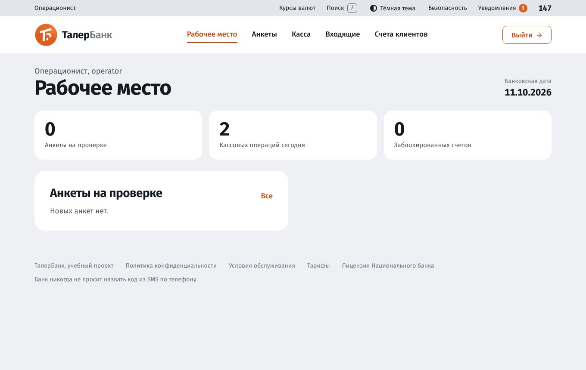
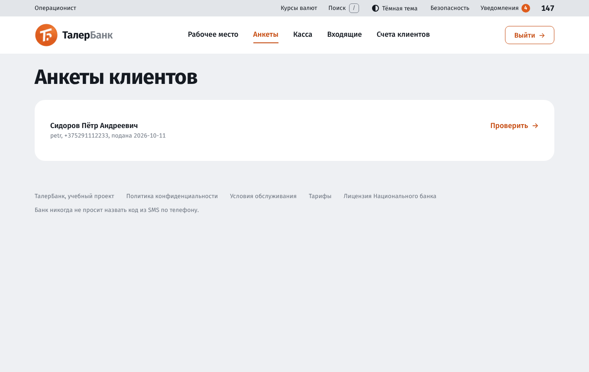
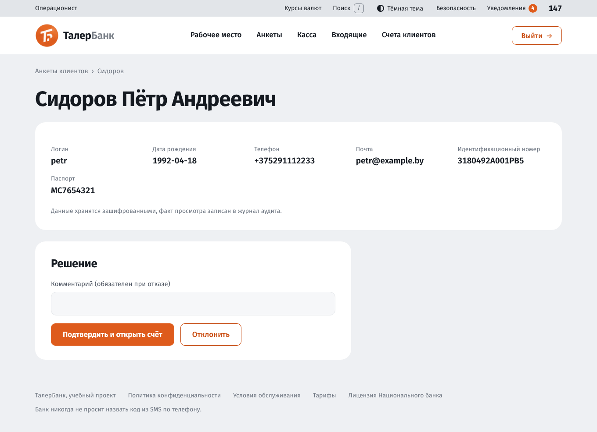
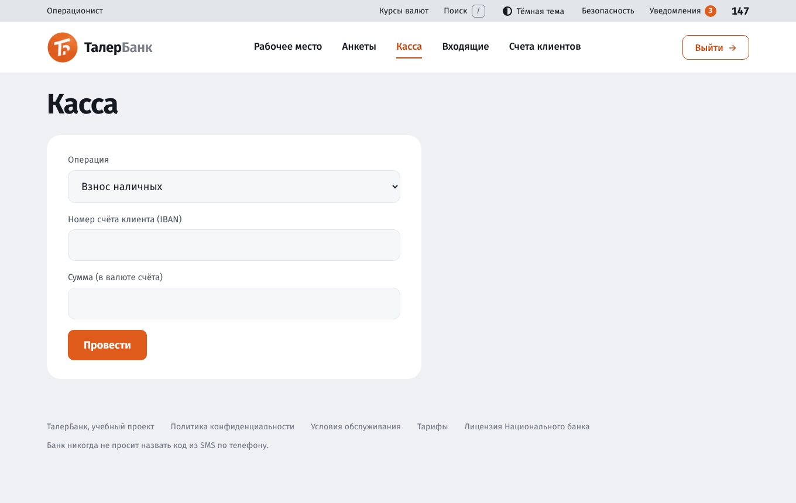
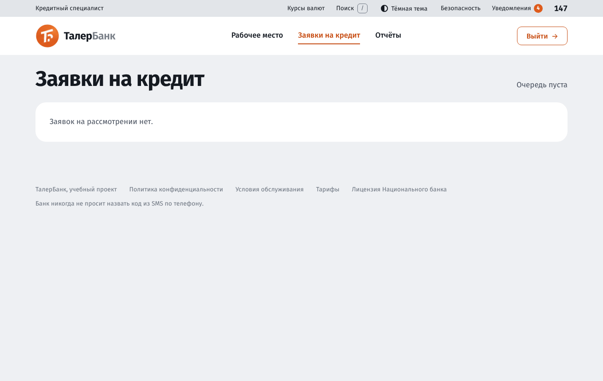
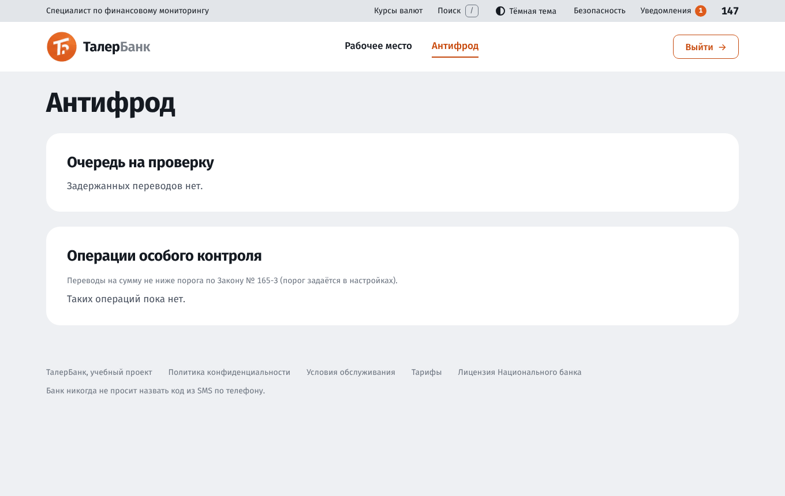

# Руководство пользователя: сотрудники банка

Руководство описывает рабочие места трёх ролей сотрудников. Администратору посвящено [отдельное руководство](user-guide-admin.md), клиентам и гостям: [руководство клиента](user-guide-client.md).

| Роль | Логин для демонстрации | Права |
|---|---|---|
| Операционист | `operator` | проверка анкет, касса, входящие платежи, блокировка счетов |
| Кредитный специалист | `credit` | рассмотрение заявок на кредит |
| Специалист по финансовому мониторингу | `monitor` | очередь антифрода, операции особого контроля |

Пароль демонстрационных сотрудников `Taler2026`. Состав доступных разделов определяется правами роли: в меню показаны только ваши.

## Содержание

1. [Вход и двухфакторная защита](#1-вход-и-двухфакторная-защита)
2. [Рабочее место](#2-рабочее-место)
3. [Операционист](#3-операционист)
4. [Кредитный специалист](#4-кредитный-специалист)
5. [Специалист по финансовому мониторингу](#5-специалист-по-финансовому-мониторингу)
6. [Общие правила работы](#6-общие-правила-работы)

## 1. Вход и двухфакторная защита

Для сотрудников двухфакторная защита обязательна и отключить её самостоятельно нельзя.

**Первый вход.**

1. Введите логин и пароль.
2. Система предложит включить защиту: установите на телефон приложение-аутентификатор (Google Authenticator, Яндекс Ключ, Aegis и др.), отсканируйте QR-код и введите шестизначный код.
3. **Сохраните резервные коды.** Каждый действует один раз.

**Последующие входы.** После пароля введите шестизначный код из приложения (он меняется каждые 30 секунд) или резервный код.

Если телефон потерян, а резервных кодов нет, обратитесь к администратору: он может временно выключить обязательную защиту на сервере.

После нескольких неверных кодов подряд вход блокируется, нужно войти заново.

## 2. Рабочее место

После входа открывается «Рабочее место» с банковской датой, показателями и ближайшими задачами **только по вашим правам**. Например, у операциониста это число анкет на проверке, у кредитного специалиста число заявок в очереди, у специалиста по мониторингу число задержанных переводов.

Пункты меню сверху зависят от роли. Раздел «Поиск» (кнопка в верхней полосе или клавиша `/`) быстро ведёт к любому разделу.

## 3. Операционист

Меню: «Рабочее место», «Анкеты», «Касса», «Входящие», «Счета клиентов».

### 3.1. Проверка анкет

Раздел «Анкеты». В списке показаны анкеты, поданные клиентами при регистрации.

1. Откройте анкету. Показаны логин, дата рождения, телефон, почта, идентификационный номер и паспорт. Данные хранятся в базе зашифрованными, а факт просмотра записывается в журнал аудита.
2. Сверьте данные с документами клиента.
3. Нажмите:
   - **«Подтвердить и открыть счёт»**: клиент становится проверенным, ему автоматически открывается первый текущий счёт в BYN, приходит уведомление;
   - **«Отклонить»**: обязательно укажите комментарий с причиной, он будет показан клиенту.

До подтверждения клиент не может открывать счета, платить, оформлять вклады, кредиты и карты.

### 3.2. Касса

Раздел «Касса»: взнос и выдача наличных.

1. Выберите операцию: «Взнос наличных» или «Выдача наличных».
2. Введите номер счёта клиента (IBAN) и сумму в валюте счёта.
3. Нажмите «Провести».

Операция проводится по двойной записи через кассу банка. При выдаче проверяется остаток: выдать больше, чем на счёте, нельзя. Заблокированный или закрытый счёт не принимает операций.

### 3.3. Входящие платежи

Раздел «Входящие»: регистрация платежа, пришедшего из другого банка. Выберите банк отправителя, введите отправителя, счёт клиента ТалерБанка (IBAN), сумму и назначение, нажмите «Зачислить». Деньги зачисляются с корреспондентского счёта на счёт клиента.

### 3.4. Счета клиентов

Раздел «Счета клиентов»: поиск по логину клиента или части номера счёта. Кнопка **«Заблокировать»** арестовывает счёт (укажите основание), **«Разблокировать»** снимает блокировку. По заблокированному счёту любые операции запрещены. Все действия попадают в журнал аудита.

## 4. Кредитный специалист

Меню: «Рабочее место», «Заявки на кредит».

### Очередь заявок

Раздел «Заявки на кредит». Заявки, которые скоринг не одобрил и не отклонил автоматически, попадают в очередь. Каждая заявка показана карточкой: номер, имя клиента, сумма, продукт, скоринговый балл и долговая нагрузка.

### Рассмотрение

Откройте заявку. Слева показана анкета заёмщика: ФИО, дата рождения, кредит (продукт, сумма, срок, первый платёж), доходы и обязательства, долговая нагрузка. Справа блок «Проверки». Если включён регрессионный скоринг, показана **вероятность дефолта** (например, 18,16 %) и вклад каждого признака в неё в процентных пунктах: красным отмечено, что повышает риск, зелёным, что снижает (возраст, доход, долговая нагрузка, стаж, иждивенцы, отношение суммы кредита к годовому доходу). Если модель не обучена или отключена, показан балл балльной карты и баллы по факторам.

Для заявки на рассмотрении:

1. При необходимости напишите комментарий.
2. Нажмите **«Одобрить»** или **«Отказать»**. Комментарий при отказе обязателен.

Клиент получит уведомление. После одобрения он сам подписывает договор кодом, и деньги зачисляются ему на счёт. Решённые заявки показываются со штампом «ОДОБРЕНО» или «ОТКАЗ».

Правила скоринга и пороги (вероятность дефолта для автоодобрения и ручного рассмотрения, предел суммы автоодобрения, максимальная нагрузка 40 %) задаёт администратор в разделе «Курсы и тарифы».

## 5. Специалист по финансовому мониторингу

Меню: «Рабочее место», «Антифрод».

### Очередь на проверку

Переводы клиентам банка и переводы в другие банки оцениваются автоматически по правилам: крупная сумма, перевод новому получателю, перевод новичка в первые дни, слишком частые переводы. Каждому правилу соответствует число баллов. При высоком суммарном балле перевод **задерживается**, деньги блокируются на счёте клиента, а случай попадает в очередь.

Откройте случай № N. Показаны клиент, сумма, счета, назначение, балл риска и сработавшие правила. Примите решение:

- **«Провести перевод»** (для перевода в другой банк «Одобрить перевод»): перевод выполняется, а перевод в другой банк ставится в очередь клиринга и уходит при закрытии операционного дня;
- **«Отклонить»**: перевод отменяется, деньги разблокируются. Комментарий обязателен.

Клиенту приходит уведомление. Решение фиксируется в журнале аудита.

### Операции особого контроля

Ниже очереди показан список операций, сумма которых не ниже порога особого контроля (по Закону № 165-З, порог задаётся в настройках). Они записываются автоматически, переводить их на решение не нужно: список нужен для контроля и отчётности.

## 6. Общие правила работы

- Все значимые действия сотрудника (просмотр паспортных данных, решения по анкетам, заявкам и переводам, блокировки) записываются в **журнал аудита**, который нельзя изменить или удалить.
- Не оставляйте открытой сессию на чужом компьютере: нажмите «Выйти».
- Сессия завершается автоматически через 8 часов.
- Если нужного раздела нет в меню, у вашей роли нет права. Обратитесь к администратору.
- Телефон поддержки в шапке 147.
